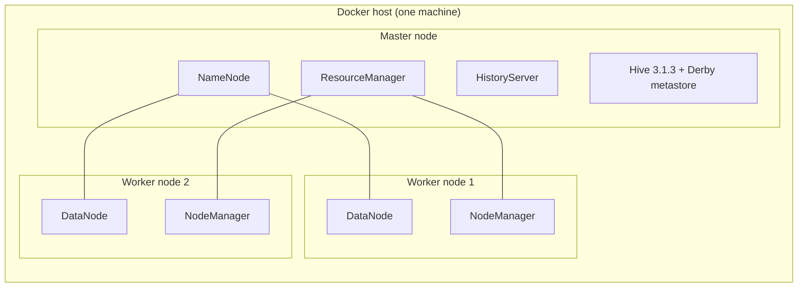

# Airline Flight Delay Analytics & Prediction

An end-to-end Big Data Analytics project analyzing 12.8 million US commercial flight records to uncover flight delay patterns, cancellations, and severe weather impacts, and to evaluate pre-departure delay risks. Built strictly within the core Apache Hadoop ecosystem (HDFS, MapReduce, Hive) executed on a distributed 3-node containerized cluster (1 master, 2 workers) running on YARN. Apache Spark and Apache Pig were deliberately excluded.

## Results at a Glance
- **Overall Operational Delay Rate**: Processed 12,648,365 operated flights across 2009–2010; 2,345,385 flights were delayed 15+ minutes (**18.54%** delay rate).
- **Airlines**: Comair (OH) had the highest delay share (**25.85%**); Hawaiian Airlines (HA) had the lowest (**7.49%**).
- **Seasonality & Scheduling**: December was the worst month (**25.38%** delay rate); September was the best (**13.44%**). Friday was the most delay-prone day of the week (**19.89%**).
- **Cancellations**: Adverse weather accounted for **46.51%** of all 200,293 cancellations, followed by carrier issues (**38.81%**).
- **Out-of-Sample Prediction**: Tested on 6,321,388 flights (year 2010); achieved **63.17% recall**, **22.58% precision** (**1.215x lift** over the 18.59% base rate), and **0.3327 F1** (beating the naive always-delayed baseline F1 of 0.3135; accuracy was 52.90% vs the 81.41% majority-class baseline).
- **Model Definition**: A count-based conditional probability estimator with hierarchical back-off ($L_1 \rightarrow L_2 \rightarrow L_3 \rightarrow L_4 \rightarrow \text{Global}$) built in HiveQL on YARN (the Hadoop-native substitute for Spark MLlib; not an iterative ML model).

## Architecture
Comprehensive architectural specifications, data flows, and design decisions are detailed in [`docs/architecture.md`](docs/architecture.md).



## Tech Stack
- **Storage**: Hadoop HDFS 3.2.1 (replication factor 2, fully mirrored across 2 DataNodes).
- **Processing**: Hadoop MapReduce (Hadoop Streaming map-only data cleaning; custom Java MapReduce aggregation job).
- **Data Warehousing & SQL**: Apache Hive 3.1.3 on YARN (external partitioned tables, Snappy-compressed ORC).
- **Predictive Model**: HiveQL conditional probability tables with hierarchical back-off (no Spark, no MLlib, no Python ML libraries).
- **Cluster Environment**: 3-node distributed architecture orchestrated via Docker Compose (7 containers on one physical machine).

## Quick Start
1. **Prerequisites**: Docker & Docker Compose installed; at least 10–15 GB free disk space.
2. **Data Placement**: Place yearly raw CSVs (`2009.csv`, `2010.csv`) inside `dataset/raw/`.
3. **Execute Pipeline**:
```bash
# Start cluster
./pipeline/run_pipeline.sh --stage cluster

# Run complete pipeline end-to-end
./pipeline/run_pipeline.sh --all

# Or list available stages
./pipeline/run_pipeline.sh --list
```

## Predict a Flight
Query delay risk for any flight schedule using the CLI predictor backed by Hive model tables on the cluster:
```bash
./src/analytics/prediction/predict_flight.sh <CARRIER> <ORIGIN> <DEST> <MONTH 1-12> <SCHEDULED_DEP_HOUR 0-23>

# Example: American Airlines flight JFK -> LAX in July departing at 9 AM
./src/analytics/prediction/predict_flight.sh AA JFK LAX 7 9
```

## Repository Structure
- `config/` — Hadoop XML configurations (`core-site.xml`, `hdfs-site.xml`, `yarn-site.xml`, `hadoop.env`, `docker-compose.yml`)
- `dataset/` — Raw and cleaned dataset references (`dataset/raw/DATASET_SOURCE.md`)
- `docs/` — Architecture notes, evidence index, demo script, project reports, and data dictionary
- `output/` — Analytics results, MapReduce outputs, prediction evaluations, and generated charts
- `pipeline/` — End-to-end pipeline runner (`run_pipeline.sh`) and documentation
- `scripts/` — Cluster lifecycle scripts, Hive execution wrappers, and verification utilities
- `screenshots/` — Cluster status, job execution logs, HDFS storage proofs, and verification dumps
- `src/ingestion/` — Raw dataset HDFS ingestion and verification scripts
- `src/processing/` — Hadoop Streaming cleaning scripts and custom Java MapReduce source (`CarrierMonthDelay.java`)
- `src/analytics/` — HiveQL analytics scripts, prediction model builders, scoring queries, and chart generator

## Evidence for Evaluation
- **Deliverables Index**: [`docs/evidence-index.md`](docs/evidence-index.md) (comprehensive matrix of configurations, proofs, logs, and outputs)
- **Live Viva Demonstration**: [`docs/demo-script.md`](docs/demo-script.md) (numbered step-by-step viva demo script with troubleshooting guide)
- **Final Project Report**: [`docs/project-report.md`](docs/project-report.md) (detailed problem statement, dataset, stage implementation, and findings)
- **Prediction Results**: [`docs/prediction-results.md`](docs/prediction-results.md) (evaluation protocol, confusion matrix, calibration, and baseline comparisons)
- **Analytics Charts**: [`docs/analytics-charts.md`](docs/analytics-charts.md) (all 13 analytical and predictive visualizations with factual captions)

## Limitations
- **Single-Machine Resource Bounds**: The 3-node cluster runs as 7 Docker containers sharing one host machine's CPU, RAM, and disk I/O.
- **Pre-Departure Feature Boundary**: The predictor utilizes only scheduled timetable metadata (carrier, route, month, hour); live radar weather and inbound aircraft arrival delays are unavailable prior to scheduling.
- **Metastore Single-Session Lock**: Embedded Derby allows only one active Hive session at a time, requiring sequential query execution.

## Team and Contributions
- **Mann** (GitHub: `mannunadkat`)
- **Teammate (name to be added)**

Contributions are recorded in the GitHub commit history of this repository:
- `mannunadkat <unadkatmann@gmail.com>`: 25 commits across 5 distinct days (cluster setup, HDFS ingestion, MapReduce cleaning, Hive analytics, Java MapReduce job, prediction model, scoring, evaluation, chart generation, orchestrator, and documentation).
- Per the team: Teammate name and additional collaborative contributions to be filled in prior to final submission.

## Status
Phase 10 of 10 complete: project finished.
