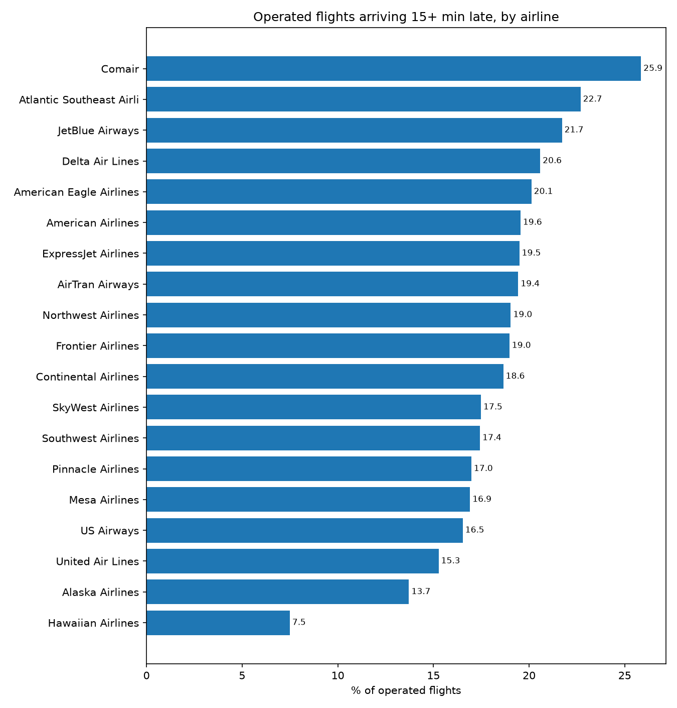
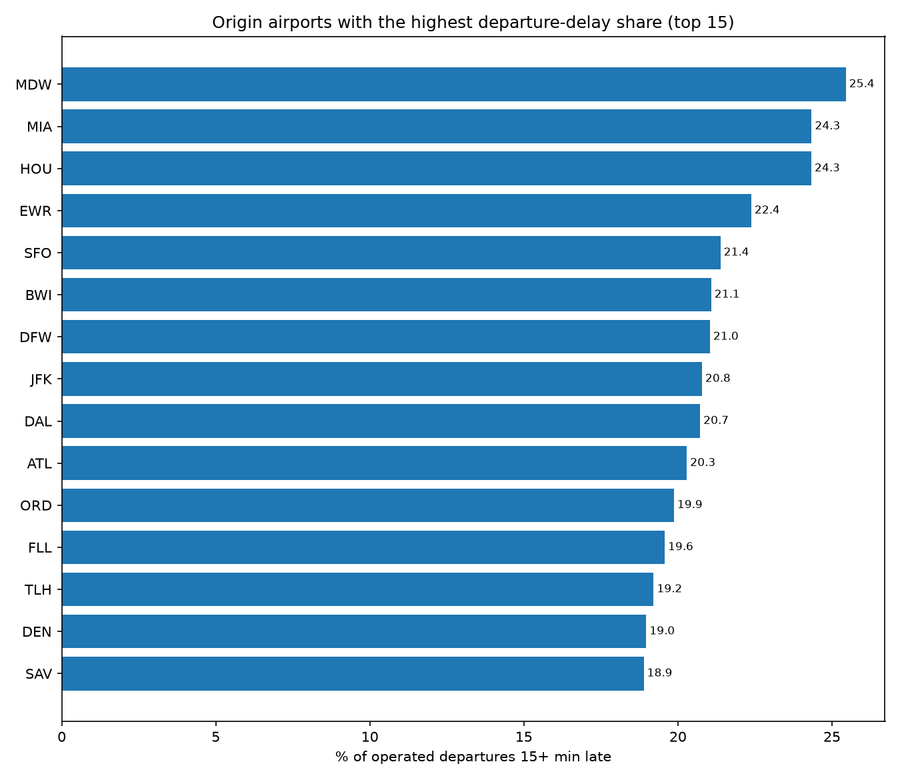
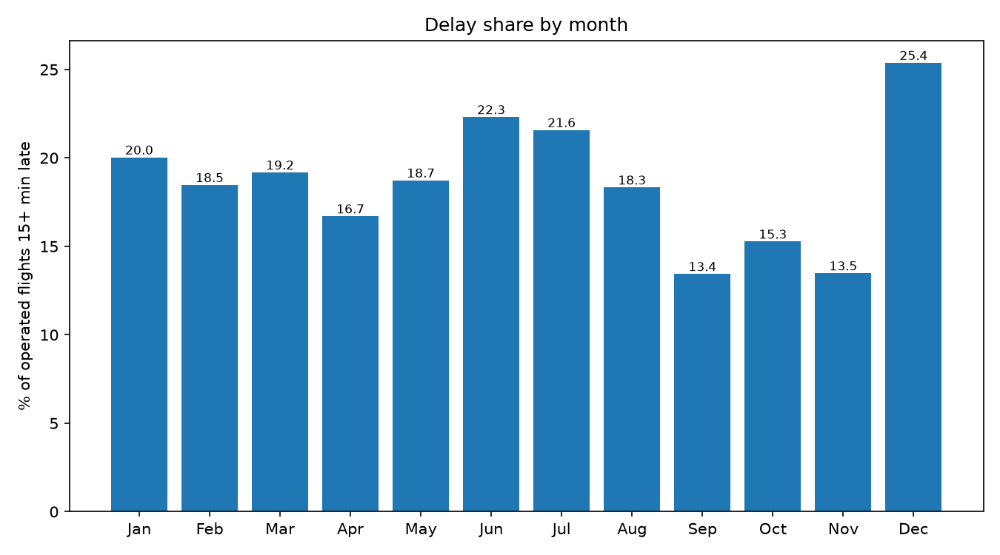
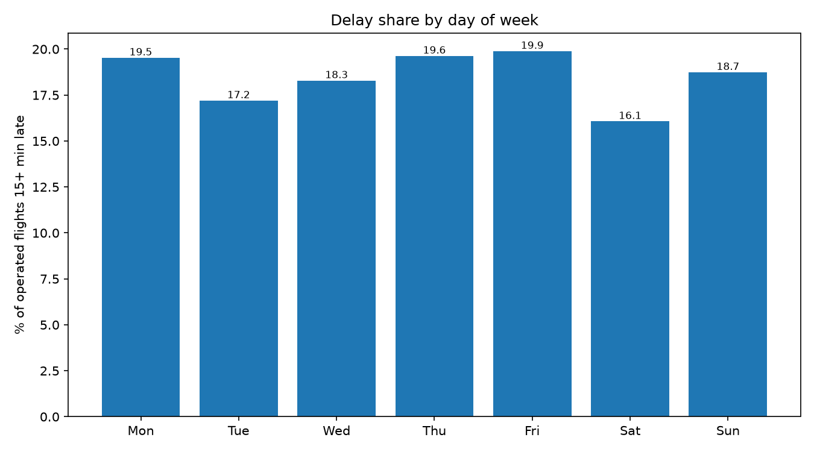
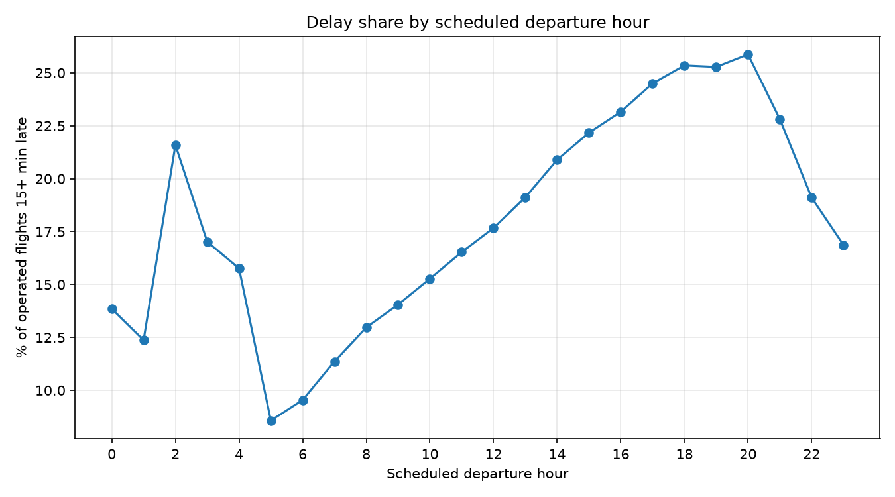
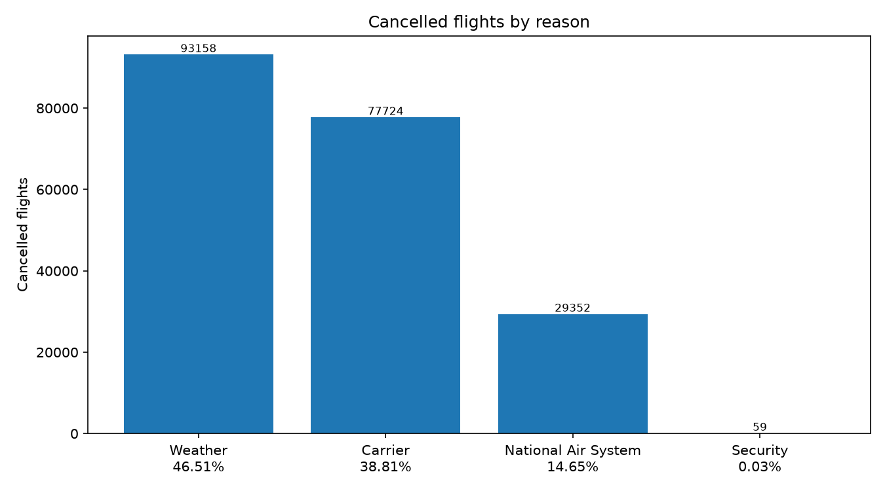
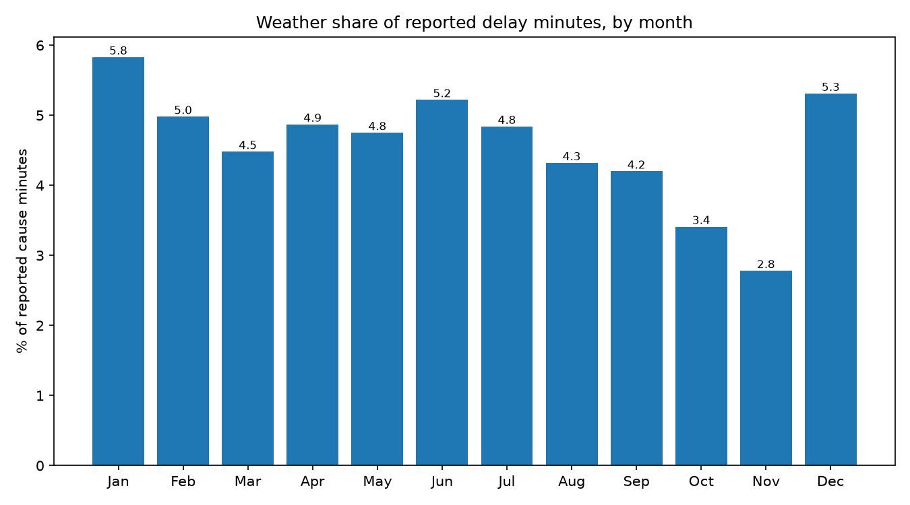
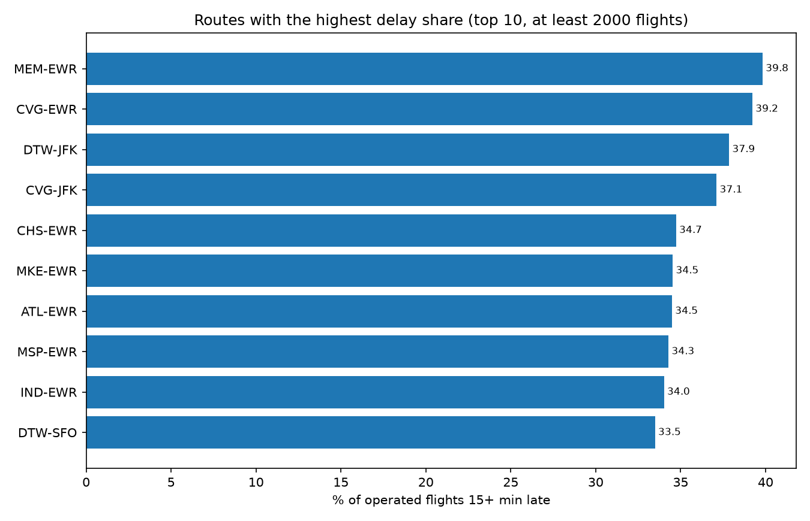

# Airline Flight Delay & Cancellation Analytics: Visualizations

This document compiles the visual analytical charts produced from the Hive analytics queries executed on the distributed Hadoop cluster. Each visualization is paired with empirical findings derived directly from the underlying cluster datasets.

---

### Chart 01: Airline Delay Share

*Comair (OH) experienced the highest delay rate at 25.85% (74,217 delayed of 287,157 operated flights), followed by Atlantic Southeast Airlines (EV) at 22.69% and JetBlue (B6) at 21.72%.*

---

### Chart 02: Origin Airport Departure Delays (Top 15)

*Chicago Midway (MDW) led major origin airports with a 25.45% departure delay share (12.38 minutes average delay), followed closely by Miami (MIA) at 24.34% and Houston Hobby (HOU) at 24.33%.*

---

### Chart 03: Delay Share by Month

*January experienced the highest delay rate across the system at 20.03% (205,584 delayed flights), while April recorded the lowest delay rate at 16.70% (175,865 delayed flights).*

---

### Chart 04: Delay Share by Day of Week

*Thursdays (19.63%) and Mondays (19.53%) registered the highest flight arrival delay frequencies, while Tuesdays were the most reliable travel days with a 17.20% delay share.*

---

### Chart 05: Delay Share by Scheduled Departure Hour

*Flight delays steadily compound throughout the operational day, rising from under 7% for dawn departures (05:00) to peak delay rates exceeding 25% between 18:00 and 21:00.*

---

### Chart 06: Flight Cancellation Reasons

*Adverse weather accounted for 46.51% of all flight cancellations (93,158 flights), while airline-controllable carrier issues represented 38.81% (77,724 flights).*

---

### Chart 07: Weather Share of Delay Minutes by Month

*Winter severe weather impacts peaked in January, accounting for 5.83% of all reported cause delay minutes (625,591 delay minutes) and 13,423 flight cancellations.*

---

### Chart 08: High-Volume Routes with the Highest Delay Share

*Among routes with at least 2,000 flights, Memphis to Newark (MEM-EWR) had the worst on-time record with 39.83% of flights delayed (24.59 minutes average arrival delay), followed by Cincinnati to Newark (CVG-EWR) at 39.23%.*
