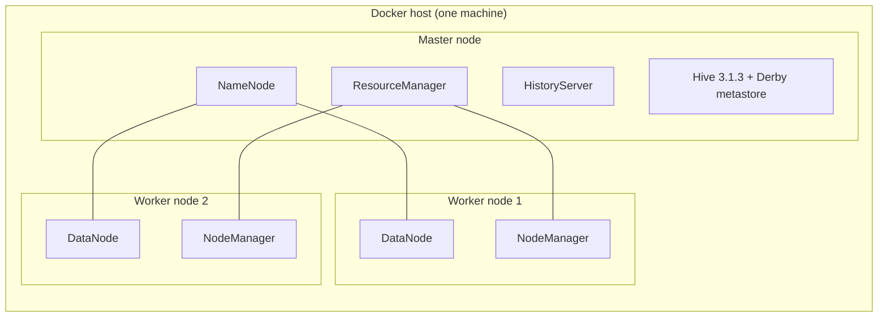
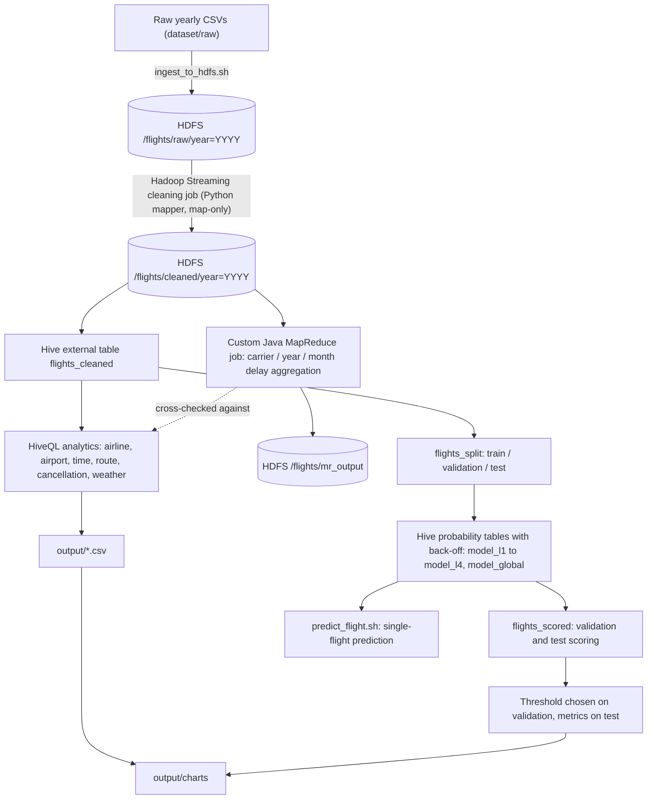

# System Architecture and Data Flow

## 1. Physical and Logical Cluster Topology

### Cluster Specification
The 3-node Hadoop cluster is deployed via Docker Compose on a single physical host machine (permissible under the course specification: VMs, containers, or cloud):

| Node Role | Docker Container(s) | Active Java Daemons | Operational Port(s) |
|:---|:---|:---|:---|
| **Master Node** | `namenode` `resourcemanager` `historyserver` | `NameNode` `ResourceManager` `ApplicationHistoryServer` Hive CLI / Derby Metastore | 9000 (HDFS RPC), 9870 (NameNode UI) 8032 (RM RPC), 8088 (YARN RM UI) 8188 (JobHistory UI) |
| **Worker Node 1** | `datanode1` `nodemanager1` | `DataNode` `NodeManager` | 9864 (DataNode UI / Transfer) 8042 (NodeManager UI) |
| **Worker Node 2** | `datanode2` `nodemanager2` | `DataNode` `NodeManager` | 9864 (DataNode UI / Transfer) 8042 (NodeManager UI) |

- **Replication Factor**: HDFS replication is set to `dfs.replication = 2`. With exactly 2 DataNodes, every block written to HDFS is fully mirrored across both worker containers (`datanode1` and `datanode2`), guaranteeing zero data loss if one worker fails.
- **Resource Management**: YARN manages memory and CPU cores on both workers, dynamically launching mapper and reducer containers on `nodemanager1` and `nodemanager2`.

---

## 2. End-to-End Data Pipeline Architecture

### Stage-by-Stage Data Flow
| Stage | Tool / Technology | Input | Output Location |
|:---|:---|:---|:---|
| **Ingestion** | `src/ingestion/ingest_to_hdfs.sh` | Local raw files `dataset/raw/YYYY.csv` | HDFS `/flights/raw/year=YYYY/` |
| **Data Cleaning** | Hadoop Streaming MapReduce (`clean_mapper.py`, map-only) | HDFS `/flights/raw/year=YYYY/` | HDFS `/flights/cleaned/year=YYYY/` |
| **Hive Warehouse** | HiveQL (`src/analytics/00_create_tables.hql`) | HDFS `/flights/cleaned/` & `carriers.csv` | Hive external tables: `flightdb.flights_cleaned`, `flightdb.carriers_ref` |
| **Airline & Airport Analytics** | Hive on YARN (`run_airline_airport_analytics.sh`) | `flightdb.flights_cleaned` | `output/airline_airport/*.csv` |
| **Time, Route, Cancel, Weather** | Hive on YARN (`run_time_route_cancel_weather.sh`) | `flightdb.flights_cleaned` | `output/time_analysis/*.csv` `output/route_analysis/*.csv` `output/cancellation_analysis/*.csv` `output/weather_analysis/*.csv` |
| **Custom MapReduce** | Java MapReduce (`CarrierMonthDelay.java`) | HDFS `/flights/cleaned/year=*/` | HDFS `/flights/mr_output` `output/mapreduce/carrier_month_delay.csv` |
| **Split Creation** | HiveQL on YARN (`01_create_split.hql`) | `flightdb.flights_cleaned` | Hive partitioned table: `flightdb.flights_split` (`train`, `validation`, `test`) |
| **Model Building** | HiveQL on YARN (`02_build_model.hql`) | `flightdb.flights_split` (`split_set = 'train'`) | Hive model tables: `model_l1`, `model_l2`, `model_l3`, `model_l4`, `model_global` `output/prediction_model/*.csv` |
| **Scoring & Evaluation** | HiveQL on YARN (`03_score.hql`, queries) | `flightdb.flights_split` & model tables | Hive table: `flightdb.flights_scored` `output/prediction_results/*.csv` |
| **Chart Generation** | Python 3 + Matplotlib (`make_charts.py`) | All CSV files in `output/` | `output/charts/*.png` (13 charts) |

---

## 3. Architecture & Engineering Design Decisions

1. **External Tables over HDFS Directories**:
   All primary Hive tables (`flights_cleaned`, `flights_split`) are declared `EXTERNAL` pointing to underlying HDFS directories. This decouples storage lifecycle from metadata lifecycle, ensuring data survives schema drops or metastore rebuilds.
2. **Year Partitioning**:
   The primary dataset is partitioned on HDFS by `year=YYYY`. Queries targeting specific years or evaluating temporal splits prune irrelevant directory partitions immediately, avoiding full-table scans.
3. **Rigorous Operational Definition of Delay**:
   In strict conformance with US DOT FAA standards, `is_delayed = 1` is defined as: **flight was not cancelled AND arrival delay $\ge 15$ minutes**. Cancelled flights are retained with departure and arrival delays explicitly zeroed to prevent skewing numerical delay aggregates.
4. **Temporal Hold-Out Test Split**:
   The entire latest year (2010) is reserved as an out-of-sample temporal test hold-out. Training (2009 hash $\ne 0$) and validation (2009 hash $= 0$) are split deterministically via MD5 hash modulo 10 to simulate real-world forward-testing.
5. **Pre-Departure Feature Restriction**:
   Features used for prediction are restricted to variables known prior to pushback: carrier, origin, destination, month, and scheduled departure hour bucket (4-hour intervals: 00–03, 04–07, 08–11, 12–15, 16–19, 20–23). Actual departure delay, taxi-out time, airborne time, and in-flight delay metrics are strictly excluded to prevent data leakage.
6. **Hierarchical Back-off Probability Model**:
   Because Apache Spark and Spark MLlib were strictly prohibited, the project implements a distributed count-based conditional probability model with 5-level hierarchical back-off ($L_1 \rightarrow L_2 \rightarrow L_3 \rightarrow L_4 \rightarrow \text{Global}$) with support threshold $n \ge 30$, built and scored purely with HiveQL on YARN.

---

## 4. Hardware Constraints & Known Limitations

- **Single-Host Resource Sharing**:
  The 7 Docker containers run on one physical machine, sharing the host CPU cores, memory, and physical disk I/O.
- **Embedded Derby Metastore Concurrency**:
  Apache Hive runs with an embedded Apache Derby metastore in the `namenode` container. Derby acquires an exclusive file lock on `/opt/hive-data/metastore_db`. Consequently, **only ONE Hive session can run at any time**. Concurrent queries must be queued sequentially.
- **Volume Persistence**:
  Cluster storage is backed by Docker local named volumes (`hadoop_namenode`, `hadoop_datanode1`, `hadoop_datanode2`, `hadoop_historyserver`, `hive_data`), ensuring cluster state and HDFS blocks survive container restarts.

---

## 5. Execution
The end-to-end pipeline can be executed or inspected using the orchestrator:
- Overview: [`pipeline/README.md`](../pipeline/README.md)
- Available stages: `./pipeline/run_pipeline.sh --list`
- Stage execution: `./pipeline/run_pipeline.sh --stage <name>`
