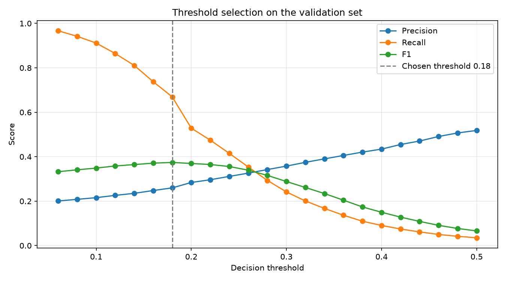
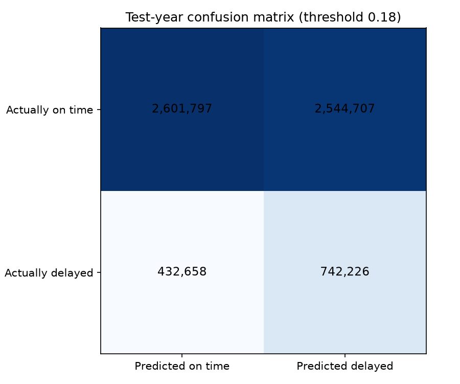
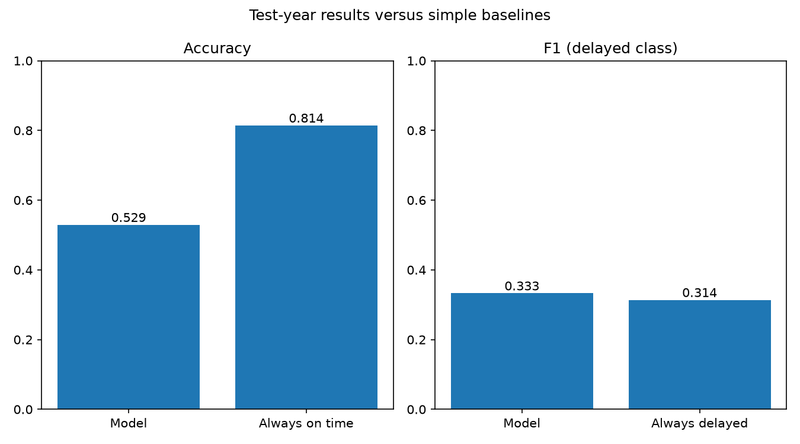
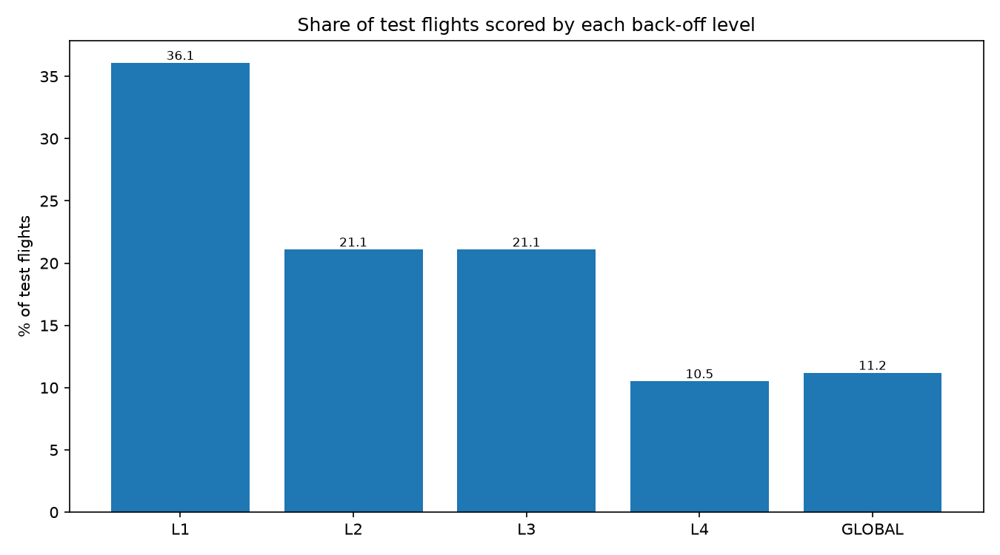
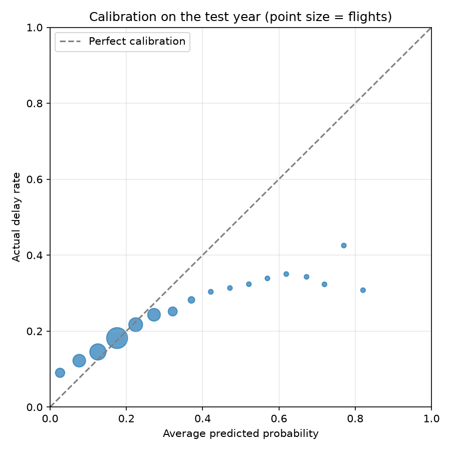

# Flight Delay Prediction: Scoring, Evaluation, and Performance Results

## 1. Purpose and Model Definition
This phase completes the delay prediction pipeline for the **Airline Flight Delay Analytics & Prediction** project. 

> [!IMPORTANT]
> **Hadoop-Native Implementation Notice**  
> In strict accordance with the project constraints, **Apache Spark, Apache Pig, Spark MLlib, and Python ML libraries (such as scikit-learn) were NOT used**.
>
> The prediction model is a **count-based historical-probability estimator with hierarchical back-off**, implemented purely in **HiveQL on YARN**. It is **not** a trained iterative machine learning algorithm (like logistic regression, random forests, or gradient boosted trees). It estimates the conditional probability that an operated flight will arrive **15 or more minutes late** based on empirical frequencies in historical training data.

---

## 2. Evaluation Protocol and Leakage Controls
To guarantee strict statistical integrity and prevent data leakage:
1. **Temporal Hold-Out Test Set**: The entire year **2010** (6,321,388 operated flights) was reserved strictly as a temporal test set.
2. **Train/Validation Split**: Historical data from **2009** was deterministically split via hash modulo into ~90% training (**5,693,875** flights) and ~10% validation (**633,102** flights).
3. **Training Only for Model Tables**: All conditional probability tables (`model_l1`, `model_l2`, `model_l3`, `model_l4`, `model_global`) with minimum support $n \ge 30$ were computed strictly from the `train` partition.
4. **Validation Only for Threshold Tuning**: The decision threshold was chosen by sweeping candidate thresholds ($0.06$ to $0.50$ in steps of $0.02$) solely on the `validation` set to maximize the F1-score.
5. **One-Time Test Evaluation**: The test set was scored and evaluated **once** using the chosen threshold. No feature tuning, model table adjustment, or threshold re-selection was performed after viewing the test results.

---

## 3. Threshold Selection on the Validation Set
The threshold sweep on the 633,102 validation flights evaluated precision, recall, and F1 across 23 probability thresholds:

| Threshold | True Pos (TP) | False Pos (FP) | False Neg (FN) | True Neg (TN) | Precision | Recall | F1 Score | Accuracy |
|:---------:|:-------------:|:--------------:|:--------------:|:-------------:|:---------:|:------:|:--------:|:--------:|
| 0.06 | 113,740 | 452,757 | 3,910 | 62,695 | 0.2008 | 0.9668 | 0.3325 | 0.2787 |
| 0.10 | 107,221 | 389,809 | 10,429 | 125,643 | 0.2157 | 0.9114 | 0.3489 | 0.3678 |
| 0.14 | 95,412 | 310,252 | 22,238 | 205,200 | 0.2352 | 0.8110 | 0.3646 | 0.4748 |
| 0.16 | 86,768 | 263,354 | 30,882 | 252,098 | 0.2478 | 0.7375 | 0.3710 | 0.5352 |
| **0.18** | **78,714** | **224,227** | **38,936** | **291,225** | **0.2598** | **0.6691** | **0.3743** | **0.5843** |
| 0.20 | 62,181 | 156,654 | 55,469 | 358,798 | 0.2841 | 0.5285 | 0.3696 | 0.6649 |
| 0.24 | 48,838 | 107,936 | 68,812 | 407,516 | 0.3115 | 0.4151 | 0.3559 | 0.7208 |
| 0.30 | 28,427 | 51,041 | 89,223 | 464,411 | 0.3577 | 0.2416 | 0.2884 | 0.7784 |
| 0.40 | 10,667 | 13,902 | 106,983 | 501,550 | 0.4342 | 0.0907 | 0.1500 | 0.8091 |
| 0.50 | 4,147 | 3,855 | 113,503 | 511,597 | 0.5182 | 0.0352 | 0.0660 | 0.8146 |

- **Chosen Decision Threshold**: **`0.18`**
- **Validation Metrics at Chosen Threshold**: Precision = **0.2598**, Recall = **0.6691**, F1 = **0.3743**, Accuracy = **0.5843**.



---

## 4. Test Set Evaluation Results (Year 2010)
Scoring all 6,321,388 operated test flights on YARN produced the following empirical confusion matrix and metrics:

### Confusion Matrix (Test Set, Threshold = 0.18)
```
                          PREDICTED
                   On Time        Delayed        Total
ACTUAL  On Time    2,601,797 (TN) 2,544,707 (FP) 5,146,504
        Delayed      432,658 (FN)   742,226 (TP) 1,174,884
        Total      3,034,455      3,286,933      6,321,388
```



### Performance Metrics & Baseline Comparisons
- **Total Test Rows**: 6,321,388
- **Test Delay Rate**: 18.59% (1,174,884 delayed flights)
- **True Positives (TP)**: 742,226
- **False Positives (FP)**: 2,544,707
- **False Negatives (FN)**: 432,658
- **True Negatives (TN)**: 2,601,797
- **Accuracy**: **0.5290** (52.90%)
- **Precision**: **0.2258** (22.58%)
- **Recall**: **0.6317** (63.17%)
- **F1 Score**: **0.3327**
- **Precision Lift over Base Rate**: **1.215x** (22.58% vs 18.59%)
- **Majority-Class Baseline Accuracy (Always On Time)**: **0.8141** (81.41%)
- **Always-Delayed Baseline F1**: **0.3135**



### Honest Assessment vs Baselines
- **F1 Score**: The model's F1 score of **0.3327** beats the naive "always delayed" baseline of **0.3135**.
- **Precision Lift**: The model provides a **1.215x lift** in delay detection: when the model flags a flight as delayed, the actual likelihood is 22.58%, compared to the random baseline delay rate of 18.59%.
- **Accuracy Trade-off**: The model's overall accuracy (**0.5290**) does **NOT** beat the majority baseline accuracy (**0.8141**). As highlighted by the validation warning:
  > *`WARN: accuracy 0.529 does not beat the majority baseline 0.8141`*
  This trade-off is mathematically expected when predicting a minority class (18.59% prevalence). A naive predictor that blindly outputs "On Time" for every flight achieves 81.41% accuracy but has zero utility (0.0% recall, identifying zero delayed flights). Choosing the threshold that maximizes F1 (0.18) prioritizes capturing nearly two-thirds of all delayed flights (63.17% recall), which incurs substantial false positives and reduces total accuracy.

---

## 5. Back-off Level Usage on the Test Set
Every test flight was scored using the most specific available historical frequency:

| Back-off Level | Key Definition | Test Flights Scored | Share of Test | Actual Delay % | Avg Pred $p$ | Accuracy |
|:---:|:---|:---:|:---:|:---:|:---:|:---:|
| **L1** | Carrier + Origin + Dest + Month + Hour Bucket | 2,281,131 | **36.09%** | 18.15% | 0.1874 | 0.5713 |
| **L2** | Carrier + Origin + Month + Hour Bucket | 1,333,797 | **21.10%** | 19.55% | 0.1936 | 0.5554 |
| **L3** | Origin + Hour Bucket | 1,333,452 | **21.09%** | 18.65% | 0.1870 | 0.5711 |
| **L4** | Carrier + Hour Bucket | 665,163 | **10.52%** | 18.53% | 0.1837 | 0.6170 |
| **GLOBAL** | Global 2009 Training Rate ($p = 0.1849$) | 707,845 | **11.20%** | 18.08% | 0.1849 | 0.1808 |
| **Total** | | **6,321,388** | **100.00%** | **18.59%** | **0.1877** | **0.5290** |

- **57.19%** of test flights were scored by specific route/carrier-month tables (L1 + L2).
- Only **11.20%** fell back to the global rate. For global fallback rows, because $p_{\text{global}} = 0.1849 \ge 0.18$, all are classified as delayed, yielding an accuracy equal to the actual delay rate (18.08%).



---

## 6. Model Calibration on the Test Set
Calibration assesses whether an estimated probability of $p$ corresponds to an empirical delay rate of $p$:

| $p$ Bin Range | Test Flights | Avg Predicted $p$ | Actual Delay Rate | Empirical Gap |
|:---:|:---:|:---:|:---:|:---:|
| 0.00 – 0.05 | 367,415 | 0.0262 | 0.0901 | +0.0639 |
| 0.05 – 0.10 | 685,491 | 0.0765 | 0.1221 | +0.0456 |
| 0.10 – 0.15 | 1,129,887 | 0.1254 | 0.1451 | +0.0197 |
| 0.15 – 0.20 | 1,883,663 | 0.1757 | 0.1816 | +0.0059 |
| 0.20 – 0.25 | 819,697 | 0.2245 | 0.2169 | -0.0076 |
| 0.25 – 0.30 | 691,071 | 0.2725 | 0.2430 | -0.0295 |
| 0.30 – 0.35 | 347,624 | 0.3215 | 0.2517 | -0.0698 |
| 0.35 – 0.40 | 184,474 | 0.3706 | 0.2821 | -0.0885 |
| 0.40 – 0.45 | 99,908 | 0.4214 | 0.3035 | -0.1179 |
| 0.45 – 0.50 | 46,165 | 0.4716 | 0.3134 | -0.1582 |
| 0.50 – 0.55 | 35,445 | 0.5213 | 0.3235 | -0.1978 |
| 0.55 – 0.60 | 16,559 | 0.5699 | 0.3388 | -0.2311 |
| 0.60 – 0.65 | 8,224 | 0.6193 | 0.3502 | -0.2691 |
| 0.65 – 0.70 | 3,561 | 0.6725 | 0.3429 | -0.3296 |
| 0.70 – 0.75 | 1,272 | 0.7195 | 0.3231 | -0.3964 |
| 0.75 – 0.80 | 529 | 0.7703 | 0.4253 | -0.3450 |
| 0.80 – 0.85 | 403 | 0.8206 | 0.3077 | -0.5129 |



- **Moderate probabilities (0.10 to 0.25)**: Predictions track reality well (gap $< 0.02$), which encompasses over 60% of all flights.
- **High probability bins ($p > 0.40$)**: The model shows overconfidence; the actual delay rate tops out around 30%–35%, leading to a maximum calibration gap of **-0.5129** in the highest bin. This demonstrates regression to the mean in the out-of-sample year 2010.

---

## 7. Segmented Performance: Carriers & Time of Day

### Top 12 Carriers by Flight Volume
| Carrier | Test Flights | Actual Delay % | Predicted Delayed % | Accuracy | Precision | Recall |
|:---:|:---:|:---:|:---:|:---:|:---:|:---:|
| **WN** | 1,110,724 | 19.56% | 43.05% | 0.5975 | **0.2597** | 0.5717 |
| **DL** | 716,495 | 20.85% | 65.66% | 0.4365 | 0.2297 | 0.7230 |
| **OO** | 585,940 | 19.10% | 36.86% | **0.6282** | 0.2548 | 0.4918 |
| **AA** | 529,860 | 18.70% | 55.93% | 0.5070 | 0.2265 | 0.6773 |
| **MQ** | 423,828 | 20.56% | 54.66% | 0.5162 | 0.2455 | 0.6528 |
| **US** | 400,138 | 15.53% | 48.94% | 0.5399 | 0.1886 | 0.5944 |
| **XE** | 375,891 | 20.33% | 48.77% | 0.5554 | 0.2526 | 0.6060 |
| **UA** | 337,323 | 13.39% | 47.52% | 0.5565 | 0.1742 | 0.6183 |
| **EV** | 311,787 | 18.70% | 81.76% | 0.3184 | 0.1975 | **0.8638** |
| **9E** | 252,966 | 18.90% | 38.43% | 0.5859 | 0.2072 | 0.4211 |
| **FL** | 245,539 | 16.05% | 71.94% | 0.3811 | 0.1814 | 0.8132 |
| **CO** | 236,665 | 17.69% | 48.96% | 0.5469 | 0.2180 | 0.6034 |

- **Best Recall**: **EV** (Atlantic Southeast Airlines) at **86.38%**, followed by **FL** (81.32%) and **DL** (72.30%).
- **Worst Recall**: **9E** (Endeavor Air) at **42.11%** and **OO** (SkyWest) at **49.18%**.
- **Best Precision**: **WN** (Southwest Airlines) at **25.97%** and **OO** (25.48%).
- **Worst Precision**: **UA** (United Airlines) at **17.42%** and **FL** (18.14%).

### Scheduled Departure Time Buckets
| Bucket | Hours | Test Flights | Actual Delay % | Predicted Delayed % | Accuracy | Precision | Recall |
|:---:|:---:|:---:|:---:|:---:|:---:|:---:|:---:|
| 0 | 00–03 | 13,396 | 13.59% | 45.42% | 0.5513 | 0.1557 | 0.5200 |
| 1 | 04–07 | 932,011 | 9.95% | 21.63% | **0.7332** | 0.1132 | 0.2461 |
| 2 | 08–11 | 1,672,284 | 14.28% | 33.27% | 0.6338 | 0.1643 | 0.3827 |
| 3 | 12–15 | 1,594,997 | 19.91% | 60.50% | 0.4574 | 0.2162 | 0.6569 |
| 4 | 16–19 | 1,582,575 | 25.07% | 74.67% | 0.4046 | **0.2692** | **0.8017** |
| 5 | 20–23 | 526,125 | 24.16% | 71.47% | 0.4249 | 0.2667 | 0.7891 |

- **Best Accuracy**: Bucket 1 (04–07 AM) at **73.32%**, reflecting minimal compounding network delay.
- **Highest Recall & Precision**: Bucket 4 (16–19 PM) with recall of **80.17%** and precision of **26.92%**, capturing late-day cascading delays.
- **Worst Accuracy**: Bucket 4 (16–19 PM) at **40.46%** due to high variance and frequent late-afternoon schedule disruption.

---

## 8. Single-Flight Prediction Tool & Demonstration
The interactive single-flight predictor script queries Hive tables via CLI:

```bash
./src/analytics/prediction/predict_flight.sh <CARRIER> <ORIGIN> <DEST> <MONTH 1-12> <SCHEDULED_DEP_HOUR 0-23>
```

### 3-Flight Demonstration Execution Output
```
### Demo 1: the most common carrier/route/month/time combination in the training data
Flight: HA OGG -> HNL, month 9, scheduled departure hour 13 (time bucket 3)
Model level used: L1 (based on 432 historical flights)
Estimated probability of arriving 15+ minutes late: 6.0%
Decision threshold (chosen on validation data): 0.18
Prediction: LIKELY ON TIME
Note: a statistical estimate from historical frequencies, not a guarantee.

### Demo 2: the highest-risk combination (at least 200 training flights)
Flight: EV CHA -> ATL, month 9, scheduled departure hour 13 (time bucket 3)
Model level used: L1 (based on 202 historical flights)
Estimated probability of arriving 15+ minutes late: 54.5%
Decision threshold (chosen on validation data): 0.18
Prediction: LIKELY DELAYED (15+ minutes late)
Note: a statistical estimate from historical frequencies, not a guarantee.

### Demo 3: a combination never seen in training (expect fallback to the global rate)
Flight: XX AAA -> BBB, month 1, scheduled departure hour 10 (time bucket 2)
Model level used: GLOBAL (based on 5693875 historical flights)
Estimated probability of arriving 15+ minutes late: 18.5%
Decision threshold (chosen on validation data): 0.18
Prediction: LIKELY DELAYED (15+ minutes late)
Note: a statistical estimate from historical frequencies, not a guarantee.
```

---

## 9. Real-World Limitations
1. **Feature Set Constraints**: Predictions rely solely on scheduled parameters (carrier, route, month, scheduled departure time). The model does not have access to live meteorological forecasts, radar storm data, inbound aircraft delays, turn-around ground time, or FAA ground delay programs.
2. **Validation Sample Composition**: The validation flights were sampled from the same year (2009) as the training set, which makes threshold selection slightly optimistic when applied to out-of-sample future years (2010).
3. **Temporal Out-of-Sample Drift**: Airspace rules, airline schedules, and carrier mergers (e.g. Delta-Northwest integration in 2009–2010) alter operational baselines between training (2009) and testing (2010).
4. **Historical Frequency vs. Prediction**: Probabilities reflect empirical historical delay rates and should be interpreted as risk estimates rather than deterministic guarantees.

---

## 10. Verification Suite and Cluster Proofs

### Automated Scoring Validation Output (`validate_scoring.sh`)
```
OK   scored_counts.csv exists and is non-empty
OK   threshold_sweep_validation.csv exists and is non-empty
OK   threshold_sweep_test.csv exists and is non-empty
OK   test_metrics.csv exists and is non-empty
OK   level_usage_test.csv exists and is non-empty
OK   calibration_test.csv exists and is non-empty
OK   carrier_performance_test.csv exists and is non-empty
OK   hour_bucket_performance_test.csv exists and is non-empty
OK   chosen_threshold.txt exists and is non-empty
OK   scored rows and delayed counts equal the phase 8 split summary (validation, test)
Test metrics at threshold 0.18: tp=742226 fp=2544707 fn=432658 tn=2601797 rows=6321388 acc=0.529 prec=0.2258 recall=0.6317 f1=0.3327 baseline_acc=0.8141 baseline_f1=0.3135 lift=1.215
OK   confusion matrix sums to 6321388 = test rows
OK   accuracy matches the confusion matrix
OK   test delay_pct 18.59 matches the split summary (18.59)
OK   test metrics equal the test sweep row at the chosen threshold
OK   validation sweep has 23 thresholds
OK   test sweep has 23 thresholds
OK   chosen threshold 0.18 has the maximum validation F1 (0.3743)
OK   level usage covers all 6321388 test flights
OK   level usage percentages sum to 100
OK   only known back-off levels used
OK   calibration bins cover all 6321388 test flights
OK   calibration probabilities and rates within [0,1]
OK   carrier performance rows: 12
OK   hour bucket performance rows: 6
WARN accuracy 0.529 does not beat the majority baseline 0.8141 (expected when delays are the minority class and the threshold maximises F1; judge the model on precision, recall, F1 and lift instead)
OK   F1 0.3327 beats the always-delayed baseline 0.3135
OK   precision lift over the base delay rate: 1.215
```

### HDFS Storage & Replication (`fsck`)
- **Path**: `/user/hive/warehouse/flightdb.db/flights_scored`
- **Total Size**: 276,116,836 bytes (263.3 MB; replicated size: 526.7 MB)
- **Status**: **HEALTHY**
- **Replication Factor**: 2 (100% minimally replicated)
- **Blocks**: 4 blocks across 2 files (`000000_0`, `000001_0`), with replicas placed on both DataNodes (`172.18.0.3:9866` and `172.18.0.5:9866`).

### YARN Execution Proof
Scoring and evaluation executed as distributed MapReduce jobs on YARN:
- **Scoring Join (`03_score.hql`)**:
  - `Starting Job = job_1791880720726_0077, Tracking URL = http://resourcemanager:8088/proxy/application_1791880720726_0077/`
  - `Number of reduce tasks not specified. Estimated from input data size: 2`
  - `Stage-1: Map: 2 Reduce: 2 Cumulative CPU: 50.85 sec SUCCESS`
  - `Stage-2: Map: 2 Reduce: 2 Cumulative CPU: 45.23 sec SUCCESS`
  - `Stage-3: Map: 3 Reduce: 2 Cumulative CPU: 57.05 sec SUCCESS`
  - `Stage-4: Map: 3 Reduce: 2 Cumulative CPU: 66.31 sec SUCCESS`
  - `Total MapReduce CPU Time Spent: 3 minutes 39 seconds 440 msec`
- **Evaluation Query (`test_metrics.hql`)**:
  - `Starting Job = job_1791976169202_0008, Tracking URL = http://resourcemanager:8088/proxy/application_1791976169202_0008/`
  - `Stage-1: Map: 2 Reduce: 1 Cumulative CPU: 11.15 sec SUCCESS`

### Artifacts and Evidence File Index
- Scored Data Proofs: `screenshots/50-hdfs-flights-scored-du.txt`, `screenshots/50b-hdfs-flights-scored-fsck.txt`
- YARN Logs & States: `screenshots/51-yarn-applications-phase9.txt`, `screenshots/52-yarn-nodes-phase9.txt`
- Single-Flight Prediction Demo: `screenshots/53-predict-flight-demo.txt`, `output/prediction_results/demo_predictions.txt`
- Generated Visualizations: `output/charts/09_threshold_sweep_validation.png` through `13_backoff_level_usage.png`
